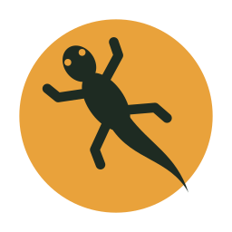

<p align="center">
  
</p>

<h1 align="center"><b>Catenga</b> Focus</h1>

<p align="center">
  A desktop time-blocking app where your notes are permanent and findable.<br>
  Plan in Google Calendar. Do the work — and write it down — here.
</p>

---

*Catenga* is a Northeast Brazil word for the small lizards (calangos) that bask in the sun. The app is built around one idea: **every note you write for a block of time lives in a markdown file you own**, is searchable, and can be browsed by day, title or tag — instead of being stuck to a moment you can never find again.

> **Status:** in active development, used daily by its author. Expect rough edges and breaking changes before 1.0. See [Roadmap](#roadmap).

## Features

- **Day timeline** — drag to create, move and resize time blocks; `←` / `→` to change day.
- **Notes per block** — a markdown editor that autosaves into one plain `.md` file per day.
- **Search** — `Cmd/Ctrl+K` full-text search across every note; open the exact day and block.
- **History** — every note for the same title or tag as one chronological list.
- **Timer** — free-running (Toggl-style) or Pomodoro runs (e.g. 4 × 25 min with 5 min breaks), with OS notifications.
- **Focus screen** — the current task, a big animated timer and the note editor, nothing else (`Cmd/Ctrl+Shift+F`).
- **Dashboard** — time by tag (and by title inside each tag), year heatmap, habit tracker and streaks (`Cmd/Ctrl+D`).
- **Goals** — "Learn Rust, 1h a day for 30 days": link a goal to a project (a recurring Google Calendar event) and/or tags (`Cmd/Ctrl+G`).
- **Google Calendar (optional)** — your events on the timeline, blocks created in the app become events.
- **Account (optional)** — passwordless magic-link sign-in. The app works fully offline and without an account.

## Your data

| What | Where | Notes |
|---|---|---|
| Notes | `~/Catenga/YYYY/MM/YYYY-MM-DD.md` | Plain markdown, one file per day. Edit them in Obsidian or VS Code — the app watches the folder. |
| Timer sessions | `~/Catenga/YYYY/MM/YYYY-MM-DD.sessions.json` | Plus a read-only `⏱ 09:05–09:50 · 45 min` line under each block. |
| Settings | `~/Catenga/config.json` | Tag colors, refresh interval, Pomodoro defaults. |
| Projects, tags, goals | `catenga.sqlite` in the app data folder | Local database, backed up before every schema change. |
| Search index | `index.sqlite` in the app cache folder | A cache — delete it any time, it is rebuilt from the files. |
| Account & Google tokens | OS keychain | Never in plain files, never sent to the server (Google tokens stay on your computer). |

When you sign in, goals/tags/projects and your notes sync between computers; notes are encrypted on your computer before upload. How it works and how to set up the server: [docs/sync-setup.md](docs/sync-setup.md).

A day file looks like this:

```markdown
## 09:00–10:30 · Deep work #mestrado

Read chapter 3 and summarised the method.

⏱ 09:05–09:50 · 45 min · pomodoro
```

## Download

Installers for macOS (Apple Silicon and Intel), Windows and Linux are attached to each [GitHub Release](https://github.com/IsmaelEzequiel/Catenga-Focus/releases).

The builds are **not signed with an Apple Developer ID or a Windows certificate yet**:

- **macOS:** open the app once, then go to *System Settings → Privacy & Security* and click **Open Anyway**. If macOS says the app "is damaged", run `xattr -dr com.apple.quarantine "/Applications/Catenga Focus.app"`.
- **Windows:** on the SmartScreen prompt click **More info → Run anyway**.

## Develop

### Requirements

- [Rust](https://rustup.rs) (stable) and the [Tauri 2 prerequisites](https://tauri.app/start/prerequisites/) for your OS
- Node.js 22 and [pnpm](https://pnpm.io) 8

### Run

```sh
pnpm install
pnpm dev          # desktop app with hot reload
pnpm server:dev   # account server on :8080 (optional)
```

Useful environment variables (all optional, read from your shell — `.env` files are not loaded):

| Variable | Purpose |
|---|---|
| `CATENGA_NOTES_DIR` | Use another notes folder (e.g. `$(mktemp -d)` to try the app without touching `~/Catenga`) |
| `CATENGA_GOOGLE_CLIENT_ID`, `CATENGA_GOOGLE_CLIENT_SECRET` | Your own Google OAuth "Desktop app" client, to enable Google Calendar |
| `CATENGA_SERVER_URL` | Point the app at another server, e.g. `http://localhost:8080` |
| `CATENGA_INDEX_DB`, `CATENGA_APP_DB`, `CATENGA_TIMER_JSON` | Other locations for the search index, app database and running-timer file |

Without Cloudflare/Resend variables the server uses a local SQLite file and prints magic links to the console, so you can develop the account flow with no cloud accounts.

### Check

The same checks run in CI:

```sh
pnpm typecheck && pnpm test
mkdir -p apps/desktop/dist
cargo fmt --all --check
cargo clippy --workspace --all-targets --locked -- -D warnings
cargo test --workspace --locked
```

### Build

```sh
pnpm build                                        # installers for your OS
docker build -f server/Dockerfile -t catenga-server .   # server image (context = repo root)
```

Pushing a `vX.Y.Z` tag builds installers for every platform on GitHub Actions and creates a draft release.

## Project layout

```
apps/desktop/          Tauri 2 app: React + TypeScript frontend (Vite)
  src-tauri/           Rust backend: files, parsing, timer, SQLite, Google Calendar
server/                Optional account server: Node + TypeScript + Express, Cloudflare D1, Resend
branding/              Logo and app icon sources
docs/plans/            One implementation plan per milestone
```

All file I/O, parsing, the timer engine, Google Calendar and the databases live in Rust; the frontend talks to them through Tauri commands.

## Roadmap

| Milestone | |
|---|---|
| Timeline, notes, search, history | ✅ |
| Account server, Google Calendar | ✅ |
| Timer, Pomodoro runs, focus screen | ✅ |
| Dashboard, goals, projects & tags | ✅ |
| Sync (notes end-to-end encrypted to Cloudflare R2) | planned |
| Quick-add (`9-10:30 deep work #tag`), shortcuts | planned |
| Run in background + menu bar "now" | planned |

The full product spec and milestones are in [`CLAUDE.md`](CLAUDE.md); ideas that are deliberately out of scope for now are in [`IDEAS.md`](IDEAS.md).

## Contributing

Contributions are welcome — please read [CONTRIBUTING.md](CONTRIBUTING.md) first. The project is intentionally focused, so open an issue to discuss a new feature before writing it.

## License

[Apache License 2.0](LICENSE) © 2026 Ismael Ezequiel.
